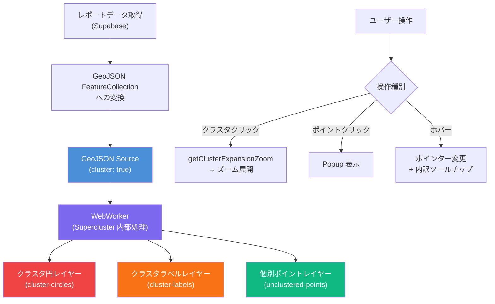

# RFC-002: 地図マーカークラスタリング

- **ステータス**: Draft
- **著者**: 合同会社コツモ（kotsumo LLC）
- **作成日**: 2026-11-18
- **対象**: MapLibre GL JS 利用者、GIS 開発者

---

## 概要

サトノメの行政向け地図画面（`gov/map`）において、野生動物の目撃・被害レポートをクラスタリング表示する機能を導入する。現在の DOM マーカー方式（`maplibregl.Marker`）を MapLibre GL JS ネイティブのクラスタリング機能に置き換えることで、**パフォーマンスの向上**と**視認性の改善**を同時に実現する。

> [!IMPORTANT]
> 本 RFC は既存の DOM マーカー方式からの移行を伴う**破壊的変更**である。ヒートマップモードとの統合も含むため、移行手順を慎重に計画する必要がある。

---

## 背景と課題

### 現在の実装

現在の地図画面（`src/app/(dashboard)/gov/map/page.tsx`、約 604 行）は、各レポートに対して個別の DOM マーカーを生成する方式を採用している。

```typescript
// 現在の方式（簡略化）
reports.forEach((report) => {
  const el = document.createElement('div');
  el.className = 'custom-marker';
  el.style.backgroundColor = ANIMAL_MARKER_COLORS[report.animalType];

  new maplibregl.Marker({ element: el })
    .setLngLat([report.longitude, report.latitude])
    .setPopup(new maplibregl.Popup().setHTML(popupContent))
    .addTo(map);

  markersRef.current.push(marker);
});
```

### 問題の構造

```
┌─────────────────────────────────────────────────────┐
│  レポート数の増加                                       │
│  ┌──────────┐    ┌──────────────┐    ┌────────────┐  │
│  │ 100 件   │ →  │ 100 DOM 要素  │ →  │ 快適       │  │
│  │ 500 件   │ →  │ 500 DOM 要素  │ →  │ もたつき    │  │
│  │ 1000 件  │ →  │ 1000 DOM 要素 │ →  │ 顕著な遅延  │  │
│  │ 5000 件+ │ →  │ 5000 DOM 要素 │ →  │ 操作困難    │  │
│  └──────────┘    └──────────────┘    └────────────┘  │
└─────────────────────────────────────────────────────┘
```

**具体的な課題:**

1. **パフォーマンス劣化**: マーカーごとに DOM ノードを生成するため、件数増加に伴い DOM ツリーが肥大化し、レンダリング・スクロール・ズーム操作が重くなる
2. **視認性悪化**: 密集地域でマーカーが重なり合い、個別のレポートを識別・選択できない
3. **メモリ消費**: 各 DOM マーカーがイベントリスナー・Popup インスタンスを保持し、メモリ使用量が線形増加する

> [!NOTE]
> ヒートマップモードでは既に GeoJSON source + レイヤー方式を採用しており、パフォーマンス上の問題は発生していない。マーカーモードでも同じアプローチに統一することが自然である。

---

## 技術選定

### 候補比較

| 観点 | ① MapLibre ネイティブクラスタリング | ② Supercluster 直接利用 | ③ サーバーサイド MVT |
|---|---|---|---|
| **追加依存** | なし（MapLibre GL JS 内蔵） | `supercluster` パッケージ | タイルサーバー（Martin 等） |
| **実装コスト** | 低（Source 設定のみ） | 中（Worker 管理必要） | 高（インフラ追加） |
| **パフォーマンス** | ◎（WebWorker 自動処理） | ◎（手動 Worker 管理） | ◎◎（サーバーで事前計算） |
| **カスタマイズ性** | ○（`clusterProperties` で集計可能） | ◎（完全制御可能） | ○（タイル生成時に決定） |
| **適正データ量** | 〜10,000 件 | 〜100,000 件 | 100,000 件〜 |
| **現データ量適合** | ✅ 最適（〜1,000 件） | ⚠ 過剰 | ⚠ 過剰 |

### 決定: ① MapLibre ネイティブクラスタリング

**選定理由:**

- **追加ライブラリ不要**: MapLibre GL JS の GeoJSON ソースに `cluster: true` を設定するだけで利用可能
- **WebWorker 自動処理**: クラスタリング計算は内部的に WebWorker で実行されるため、メインスレッドをブロックしない
- **現データ量に最適**: 現在の想定データ量（〜1,000 件）では Supercluster の直接利用やサーバーサイド MVT は過剰な複雑さを導入する
- **ヒートマップとの統合容易**: 既存のヒートマップ用 GeoJSON ソースと同一のデータ構造を共有可能
- **将来の拡張性**: データ量が 10,000 件を超える段階で Supercluster 直接利用や MVT 方式への段階的移行が可能

> [!TIP]
> MapLibre GL JS は内部的に Supercluster を使用しているため、ネイティブクラスタリングでも高品質なクラスタリング結果が得られる。将来、より細かい制御が必要になった場合のみ、Supercluster の直接利用を検討すればよい。

---

## 設計

### データフロー



### GeoJSON ソースの設定

レポートデータを GeoJSON `FeatureCollection` に変換し、クラスタリング付きソースとして登録する。

```typescript
import maplibregl from 'maplibre-gl';
import type { Map as MaplibreMap } from 'maplibre-gl';

/**
 * 動物種別ごとのマーカー色定義
 */
const ANIMAL_MARKER_COLORS: Record<string, string> = {
  deer: '#ef4444',
  boar: '#f97316',
  monkey: '#eab308',
  bear: '#dc2626',
  raccoon_dog: '#8b5cf6',
  masked_palm_civet: '#06b6d4',
  raccoon: '#10b981',
  crow: '#6b7280',
  other: '#6b7280',
};

/**
 * レポート配列を GeoJSON FeatureCollection に変換する
 */
function reportsToGeoJSON(
  reports: Report[]
): GeoJSON.FeatureCollection<GeoJSON.Point> {
  return {
    type: 'FeatureCollection',
    features: reports.map((report) => ({
      type: 'Feature',
      geometry: {
        type: 'Point',
        coordinates: [report.longitude, report.latitude],
      },
      properties: {
        id: report.id,
        animalType: report.animalType,
        title: report.title,
        reportedAt: report.reportedAt,
        color: ANIMAL_MARKER_COLORS[report.animalType] ?? ANIMAL_MARKER_COLORS.other,
      },
    })),
  };
}
```

### ソース登録

```typescript
/**
 * クラスタリング付き GeoJSON ソースを地図に追加する
 */
function addClusterSource(map: MaplibreMap, geojson: GeoJSON.FeatureCollection) {
  map.addSource('reports', {
    type: 'geojson',
    data: geojson,
    cluster: true,
    clusterMaxZoom: 14,   // ズーム 15 以降はクラスタを解除
    clusterRadius: 50,     // クラスタ化する半径（px）
    clusterProperties: {
      // 動物種別ごとの件数を集計
      deer:                ['+', ['case', ['==', ['get', 'animalType'], 'deer'], 1, 0]],
      boar:                ['+', ['case', ['==', ['get', 'animalType'], 'boar'], 1, 0]],
      monkey:              ['+', ['case', ['==', ['get', 'animalType'], 'monkey'], 1, 0]],
      bear:                ['+', ['case', ['==', ['get', 'animalType'], 'bear'], 1, 0]],
      raccoon_dog:         ['+', ['case', ['==', ['get', 'animalType'], 'raccoon_dog'], 1, 0]],
      masked_palm_civet:   ['+', ['case', ['==', ['get', 'animalType'], 'masked_palm_civet'], 1, 0]],
      raccoon:             ['+', ['case', ['==', ['get', 'animalType'], 'raccoon'], 1, 0]],
      crow:                ['+', ['case', ['==', ['get', 'animalType'], 'crow'], 1, 0]],
      other:               ['+', ['case', ['==', ['get', 'animalType'], 'other'], 1, 0]],
    },
  });
}
```

> [!NOTE]
> `clusterProperties` により、クラスタ内の動物種別分布をクラスタレベルで集計できる。これにより、クラスタ円の色を最多種別に応じて変化させたり、ホバー時に内訳を表示したりすることが可能になる。

### 3 層レイヤー構成

クラスタリング表示は以下の 3 つのレイヤーで構成される。

#### レイヤー 1: クラスタ円（circle）

クラスタを表す円。件数に応じてサイズと色が変化する。

```typescript
function addClusterCircleLayer(map: MaplibreMap) {
  map.addLayer({
    id: 'cluster-circles',
    type: 'circle',
    source: 'reports',
    filter: ['has', 'point_count'],
    paint: {
      // 件数に応じてサイズをステップ変化
      'circle-radius': [
        'step',
        ['get', 'point_count'],
        18,      // デフォルト（〜9 件）
        10, 22,  // 10 件以上
        50, 28,  // 50 件以上
        100, 34, // 100 件以上
      ],
      // 件数に応じて色をステップ変化
      'circle-color': [
        'step',
        ['get', 'point_count'],
        '#51bbd6',    // 〜9 件: 水色
        10, '#f1f075', // 10 件以上: 黄色
        50, '#f28cb1', // 50 件以上: ピンク
        100, '#e55e5e', // 100 件以上: 赤
      ],
      'circle-stroke-width': 2,
      'circle-stroke-color': '#ffffff',
      'circle-opacity': 0.85,
    },
  });
}
```

#### レイヤー 2: クラスタラベル（symbol）

クラスタ円の上に件数を表示するテキストラベル。

```typescript
function addClusterLabelLayer(map: MaplibreMap) {
  map.addLayer({
    id: 'cluster-labels',
    type: 'symbol',
    source: 'reports',
    filter: ['has', 'point_count'],
    layout: {
      'text-field': ['get', 'point_count_abbreviated'],
      'text-font': ['Noto Sans CJK JP Bold'],
      'text-size': 13,
      'text-allow-overlap': true,
    },
    paint: {
      'text-color': '#1a1a2e',
    },
  });
}
```

#### レイヤー 3: 個別ポイント（circle + symbol）

クラスタに含まれない個別のレポートポイント。動物種別に応じた色で表示する。

```typescript
function addUnclusteredPointLayer(map: MaplibreMap) {
  // 個別ポイントの円
  map.addLayer({
    id: 'unclustered-points',
    type: 'circle',
    source: 'reports',
    filter: ['!', ['has', 'point_count']],
    paint: {
      'circle-radius': 8,
      'circle-color': ['get', 'color'],
      'circle-stroke-width': 2,
      'circle-stroke-color': '#ffffff',
    },
  });

  // 個別ポイントのアイコン（オプション: 動物種別絵文字）
  map.addLayer({
    id: 'unclustered-labels',
    type: 'symbol',
    source: 'reports',
    filter: ['!', ['has', 'point_count']],
    layout: {
      'text-field': [
        'match',
        ['get', 'animalType'],
        'deer', '🦌',
        'boar', '🐗',
        'monkey', '🐒',
        'bear', '🐻',
        'raccoon_dog', '🦝',
        'crow', '🐦‍⬛',
        '',
      ],
      'text-size': 14,
      'text-offset': [0, 0],
      'text-allow-overlap': true,
    },
  });
}
```

### インタラクション

#### クラスタクリック → ズーム展開

```typescript
function setupClusterClickHandler(map: MaplibreMap) {
  map.on('click', 'cluster-circles', async (e) => {
    const features = map.queryRenderedFeatures(e.point, {
      layers: ['cluster-circles'],
    });

    if (!features.length) return;

    const feature = features[0];
    const clusterId = feature.properties?.cluster_id;

    if (clusterId == null) return;

    const source = map.getSource('reports') as maplibregl.GeoJSONSource;

    try {
      const zoom = await source.getClusterExpansionZoom(clusterId);

      map.easeTo({
        center: (feature.geometry as GeoJSON.Point).coordinates as [number, number],
        zoom: zoom,
        duration: 500,
      });
    } catch (err) {
      console.error('クラスタ展開ズーム取得エラー:', err);
    }
  });
}
```

#### ホバー → 内訳ポップアップ

```typescript
function setupClusterHoverHandler(map: MaplibreMap) {
  const popup = new maplibregl.Popup({
    closeButton: false,
    closeOnClick: false,
    offset: 15,
  });

  map.on('mouseenter', 'cluster-circles', (e) => {
    map.getCanvas().style.cursor = 'pointer';

    if (!e.features?.length) return;

    const props = e.features[0].properties;
    const coords = (e.features[0].geometry as GeoJSON.Point).coordinates as [number, number];
    const total = props?.point_count ?? 0;

    // 動物種別内訳を構築
    const animalLabels: Record<string, string> = {
      deer: 'シカ', boar: 'イノシシ', monkey: 'サル',
      bear: 'クマ', raccoon_dog: 'タヌキ',
      masked_palm_civet: 'ハクビシン', raccoon: 'アライグマ',
      crow: 'カラス', other: 'その他',
    };

    const breakdown = Object.entries(animalLabels)
      .filter(([key]) => (props?.[key] ?? 0) > 0)
      .map(([key, label]) => `<div>${label}: ${props?.[key]}件</div>`)
      .join('');

    popup
      .setLngLat(coords)
      .setHTML(`
        <div style="font-size: 13px; line-height: 1.6;">
          <strong>合計: ${total}件</strong>
          <hr style="margin: 4px 0;" />
          ${breakdown}
        </div>
      `)
      .addTo(map);
  });

  map.on('mouseleave', 'cluster-circles', () => {
    map.getCanvas().style.cursor = '';
    popup.remove();
  });
}
```

#### 個別ポイントのクリック → 詳細ポップアップ

```typescript
function setupPointClickHandler(map: MaplibreMap) {
  map.on('click', 'unclustered-points', (e) => {
    if (!e.features?.length) return;

    const feature = e.features[0];
    const props = feature.properties;
    const coords = (feature.geometry as GeoJSON.Point).coordinates as [number, number];

    const animalLabels: Record<string, string> = {
      deer: 'シカ', boar: 'イノシシ', monkey: 'サル',
      bear: 'クマ', raccoon_dog: 'タヌキ',
      masked_palm_civet: 'ハクビシン', raccoon: 'アライグマ',
      crow: 'カラス', other: 'その他',
    };

    new maplibregl.Popup({ offset: 15 })
      .setLngLat(coords)
      .setHTML(`
        <div style="font-size: 13px; line-height: 1.6;">
          <strong>${props?.title ?? '不明'}</strong>
          <div>種別: ${animalLabels[props?.animalType] ?? 'その他'}</div>
          <div>報告日: ${props?.reportedAt ?? '不明'}</div>
        </div>
      `)
      .addTo(map);
  });

  // ポイントホバー時のカーソル変更
  map.on('mouseenter', 'unclustered-points', () => {
    map.getCanvas().style.cursor = 'pointer';
  });

  map.on('mouseleave', 'unclustered-points', () => {
    map.getCanvas().style.cursor = '';
  });
}
```

### 統合: 初期化関数

```typescript
/**
 * クラスタリング付き地図レイヤーを初期化する
 * map.on('load', ...) 内で呼び出す
 */
function initClusterLayers(map: MaplibreMap, reports: Report[]) {
  const geojson = reportsToGeoJSON(reports);

  // ソース追加
  addClusterSource(map, geojson);

  // 3 層レイヤー追加（順序重要: 下から上へ）
  addClusterCircleLayer(map);
  addClusterLabelLayer(map);
  addUnclusteredPointLayer(map);

  // インタラクション設定
  setupClusterClickHandler(map);
  setupClusterHoverHandler(map);
  setupPointClickHandler(map);
}

/**
 * レポートデータが更新された場合のソース更新
 */
function updateClusterData(map: MaplibreMap, reports: Report[]) {
  const source = map.getSource('reports') as maplibregl.GeoJSONSource | undefined;
  if (!source) return;

  const geojson = reportsToGeoJSON(reports);
  source.setData(geojson);
}
```

---

## パフォーマンス考慮

### WebWorker 自動処理

MapLibre GL JS のネイティブクラスタリングは内部的に WebWorker でクラスタリング計算を実行する。開発者が明示的に Worker を管理する必要はない。

```
メインスレッド                  WebWorker
┌─────────────┐              ┌──────────────────┐
│ setData()   │  ─ 転送 →   │ Supercluster     │
│             │              │   .load()        │
│             │  ← 結果 ─   │   .getClusters() │
│ レンダリング │              └──────────────────┘
└─────────────┘
```

### 差分更新

データ更新時は `source.setData()` を呼ぶだけでよい。MapLibre 内部で差分計算が行われるため、全レイヤーの再描画は最小限に抑えられる。

```typescript
// ✅ 推奨: setData() による一括更新
useEffect(() => {
  if (!mapRef.current || !reports) return;
  updateClusterData(mapRef.current, reports);
}, [reports]);

// ❌ 非推奨: マーカーの個別追加・削除
// markersRef.current.forEach(m => m.remove());
// reports.forEach(r => new Marker(...).addTo(map));
```

### clusterMaxZoom の設定指針

| パラメータ | 推奨値 | 説明 |
|---|---|---|
| `clusterMaxZoom` | 14 | ズーム 15 以降でクラスタ解除。市街地レベルで個別表示 |
| `clusterRadius` | 50 | クラスタ化半径（px）。大きいほど積極的にクラスタ化 |

> [!TIP]
> `clusterMaxZoom` は対象地域の密度に応じて調整する。山間部中心なら `12`、市街地中心なら `15` 程度が適切。サトノメは農山村地域が主対象のため、`14` を初期値とする。

---

## ヒートマップモードとの統合

現在ヒートマップモードは独自の GeoJSON ソースを使用しているが、クラスタリング導入後は同一ソースを共有し、レイヤーの表示/非表示で切り替える構成を推奨する。

```typescript
/**
 * 表示モードを切り替える
 */
function switchDisplayMode(
  map: MaplibreMap,
  mode: 'cluster' | 'heatmap'
) {
  const clusterLayers = [
    'cluster-circles',
    'cluster-labels',
    'unclustered-points',
    'unclustered-labels',
  ];
  const heatmapLayers = ['heatmap-layer'];

  if (mode === 'cluster') {
    clusterLayers.forEach((id) => map.setLayoutProperty(id, 'visibility', 'visible'));
    heatmapLayers.forEach((id) => map.setLayoutProperty(id, 'visibility', 'none'));
  } else {
    clusterLayers.forEach((id) => map.setLayoutProperty(id, 'visibility', 'none'));
    heatmapLayers.forEach((id) => map.setLayoutProperty(id, 'visibility', 'visible'));
  }
}
```

> [!IMPORTANT]
> ヒートマップソースを `reports` ソースと統合する場合、ヒートマップレイヤーにはフィルターなし（全 feature 対象）を指定する必要がある。クラスタリングされたソースからヒートマップを生成する場合、個別ポイントとクラスタポイントの両方が考慮される。ただし、ヒートマップにはクラスタリング前の生データを使いたい場合は、ソースを分離する方が適切な場合もある。

---

## 移行手順

### Phase 1: GeoJSON ソースへの移行

**対象**: DOM マーカー方式の置き換え

1. `reportsToGeoJSON()` 変換関数を作成
2. `addClusterSource()` でクラスタリング付きソースを追加
3. 3 層レイヤー（円・ラベル・個別ポイント）を追加
4. `markersRef.current` による DOM マーカー管理コードを削除
5. `document.createElement('div')` によるカスタムマーカー生成を削除

### Phase 2: インタラクションの移行

**対象**: クリック・ホバーイベント

1. マーカーの `click` イベント → レイヤーの `click` イベントに変更
2. `Popup` を `maplibregl.Popup` のまま継続利用（生成タイミングのみ変更）
3. クラスタクリック → `getClusterExpansionZoom()` によるズーム展開を追加
4. ホバー → 内訳ポップアップを追加

### Phase 3: ヒートマップソースとの統合

**対象**: 表示モード切り替え

1. ヒートマップ用の独立ソースを削除
2. `reports` ソースにヒートマップレイヤーを追加
3. `switchDisplayMode()` による表示切り替えを実装
4. 既存のモード切り替え UI（Mantine `SegmentedControl` 等）との接続

### Phase 4: テストと調整

1. パフォーマンス計測（1,000 件でのフレームレート比較）
2. `clusterMaxZoom` / `clusterRadius` の調整
3. モバイルでのタッチ操作検証
4. アクセシビリティ確認（キーボードナビゲーション）

---

## テスト方針

### パフォーマンステスト

```typescript
// 移行前後のフレームレート比較
// Chrome DevTools > Performance タブで以下を計測:
// 1. 初期レンダリング時間
// 2. ズーム操作時の FPS
// 3. パン操作時の FPS
// 4. DOM ノード数（Elements パネルで確認）
```

| 指標 | 移行前（目標） | 移行後（目標） |
|---|---|---|
| 初期レンダリング（1,000 件） | 〜500ms | 〜100ms |
| ズーム時 FPS | 〜30fps | 〜60fps |
| DOM ノード数 | 〜1,000+ | 〜10（レイヤー分のみ） |
| メモリ使用量 | 高（マーカーごとに保持） | 低（GeoJSON データのみ） |

### 機能テスト

- [ ] クラスタ円のサイズが件数に応じて変化すること
- [ ] クラスタクリックでズーム展開すること
- [ ] 個別ポイントクリックでポップアップが表示されること
- [ ] ホバーで内訳ツールチップが表示されること
- [ ] 動物種別ごとの色が正しく表示されること
- [ ] ヒートマップ/クラスタモードの切り替えが機能すること
- [ ] データ更新時にクラスタが再計算されること

---

## 未解決事項

1. **クラスタ円の色をドミナント種に合わせるか**: 現在の設計では件数ベースのステップ色を使用しているが、クラスタ内で最も多い動物種別の色をクラスタ円に反映する案もある。`clusterProperties` で各種別の件数は集計可能だが、「最大値の種別」を Expression だけで判定するのは複雑なため、件数ベースの色を初期実装とし、フィードバックに応じて検討する。

2. **フォント（`text-font`）の可用性**: `Noto Sans CJK JP Bold` が使用するタイルサーバー（またはスタイル）のグリフに含まれているか確認が必要。含まれていない場合はフォールバックフォントを設定するか、タイルサーバーにグリフを追加する。

3. **ヒートマップソースの統合 vs 分離**: ヒートマップにクラスタリング前の生データを使いたい場合、ソースを分離する方が精度が高い。一方、同一ソースを共有すればデータ管理が簡素化される。ユースケースに応じて判断。

4. **モバイルでのクラスタタップ精度**: タッチデバイスでは指のサイズに対してクラスタ円が小さい場合がある。`clusterRadius` やタッチターゲットサイズの調整が必要か。

5. **絵文字アイコンの代替**: 個別ポイントに絵文字（🦌、🐗 等）を使用しているが、OS・ブラウザ間でレンダリングが異なる。SVG アイコンや SDF アイコンへの置き換えを検討すべきか。

6. **アニメーション**: ズーム変更時にクラスタの分裂・合体アニメーションを追加するか。MapLibre ネイティブでは直接サポートされないため、カスタム実装が必要。

---

## 参考資料

- [MapLibre GL JS: クラスタリングの例](https://maplibre.org/maplibre-gl-js/docs/examples/cluster/)
- [MapLibre GL JS: GeoJSON ソース仕様](https://maplibre.org/maplibre-style-spec/sources/#geojson)
- [Supercluster GitHub リポジトリ](https://github.com/mapbox/supercluster)
- [MapLibre GL JS: Expressions 仕様](https://maplibre.org/maplibre-style-spec/expressions/)

---

*Copyright © 2026 合同会社コツモ（kotsumo LLC）. All rights reserved.*
